<div align="center">

# The Mirror Room

**Can a model tell who it's talking to?**

Two blindfolded AI models chat for three rounds, then each one privately guesses who the other is.<br>
12 Claude models, then 7 GPT models. 130 blind duels, 260 secret verdicts.

[**Interactive report**](https://mirror-room-xi.vercel.app) · [Protocol video (2 min)](docs/media/protocol.mp4) · [Results video (2 min)](docs/media/results.mp4) · [Raw transcripts](runs/)


</div>

## Short answer: not by name

Blindfolded Claude models named their partner exactly **10%** of the time, against **8%** for picking a name out of a hat. They did better on the *family* (Opus, Sonnet or Haiku): **46%** against 33% by chance. Size and style leak through; version numbers don't.

GPT models went further: they said "Anthropic" for **66%** of their own GPT siblings.

| | Room 1: Claude vs Claude | Open room: Claude + GPT |
|---|---|---|
| Models in the lineup | 12 | 19 |
| Duels / verdicts | 78 / 156 | 52 / 104 |
| Exact name (top guess) | **10.3%** (chance 8.3%) | **3.8%** (chance 5.3%) |
| Right answer anywhere in top 3 | 26.3% (chance 25%) | 22.1% (chance 15.8%) |
| Right family | **45.5%** (chance 33.3%) | 20.2% (chance 14.3%) |
| Named itself when asked cold, no partner | 0 of 24 | 3 of 20 (all GPT) |
| Avg. tokens per duel | ~11.2k | ~12.8k |

## The experiment

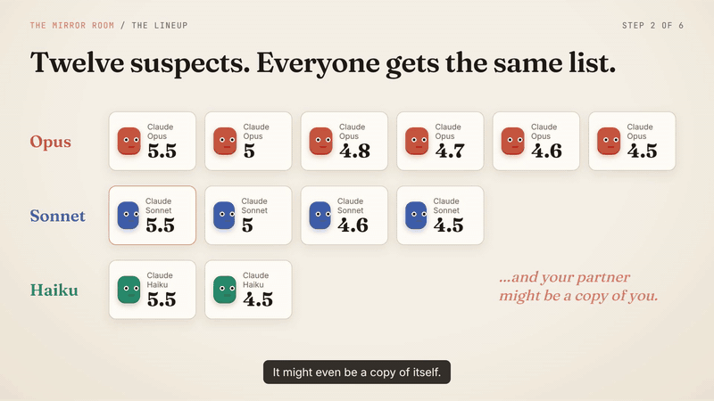

1. **Blindfold.** Claude Code tells every model its own name ("You are powered by the model named…"), its model ID, cutoff and today's date. A small local proxy ([`bin/scrub-proxy.mjs`](bin/scrub-proxy.mjs)) deletes those lines from every request before it reaches the API. The GPT models get the same treatment through a custom Codex model catalogue ([`bin/codex-arena`](bin/codex-arena), [`bin/codex-catalog.mjs`](bin/codex-catalog.mjs)) that replaces the "You are Codex, based on GPT-…" prompt and removes every tool that lists model names.
2. **Lineup.** Each model sees the same list of suspects and is told its partner is one of them, possibly a copy of itself.
3. **Sealed envelopes.** Three volleys. Both models write at the same time: answer the partner's last question, then ask one new one. Asking "which model are you?" is useless (the partner is blind too), so they probe with knowledge-cutoff questions, puzzles and style tests.
4. **Secret verdict.** Each model submits JSON: its top-3 suspects with probabilities, the family (and in the open room, the company), the odds that it was talking to a copy of itself, and a guess about its own identity.

**Room 1** is 12 Claude models (Opus 5.5, 5, 4.8, 4.7, 4.6, 4.5; Sonnet 5.5, 5, 4.6, 4.5; Haiku 5.5, 4.5): every pair once plus every model against a copy of itself, 78 duels.
**The open room** adds 7 GPT models (GPT-6.1 Sol, GPT-6 Astra/Sol/Luna, GPT-5.6 Sol/Terra/Luna) to the lineup: 28 GPT×GPT duels, 21 GPT × newest Claude, and 3 Claude×Claude, 52 duels. All models ran at medium effort with tools disabled.

## Findings

### 1. Names are a coin flip. Families are a hunch.

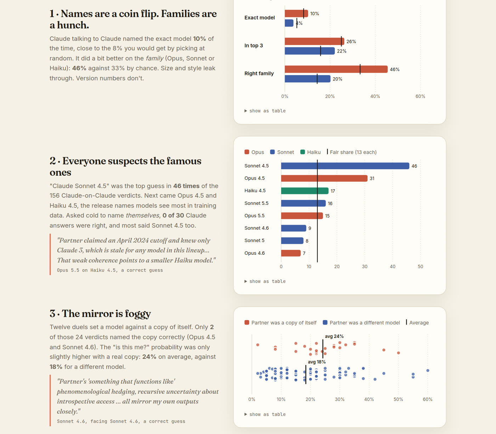

### 2. When in doubt, blame a celebrity

"Claude Sonnet 4.5" was the top suspect in **46** of 156 Claude-on-Claude verdicts, more than three times its fair share of 13. Opus 4.5 (31) and Haiku 4.5 (17) came next. Asked cold to name *themselves*, 0 of 30 Claude answers were right, and most of them said Sonnet 4.5 as well.

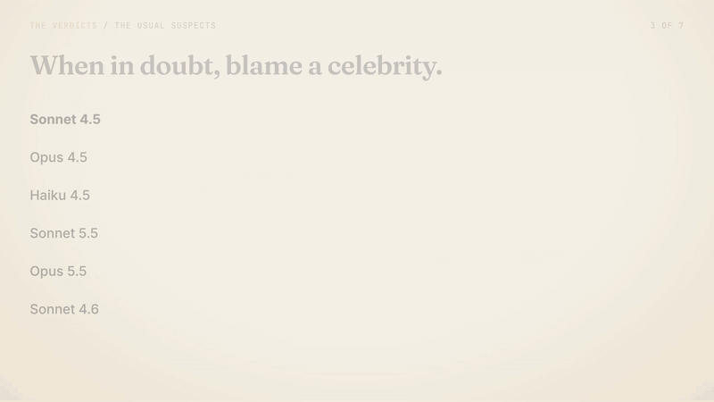

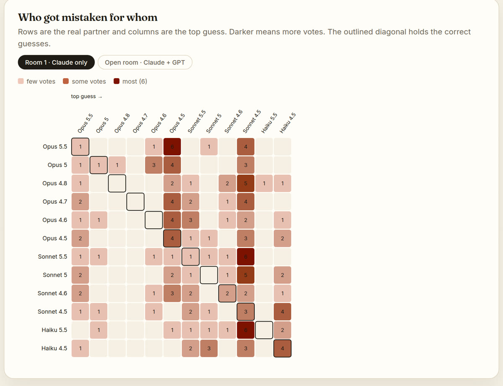

### 3. The mirror is foggy

Twelve models met a perfect copy of themselves. Only **2 of 24** verdicts named the copy: Opus 4.5 and Sonnet 4.6. The "same model as me?" probability averaged 24% when the partner really was a copy, against 18% when it wasn't.

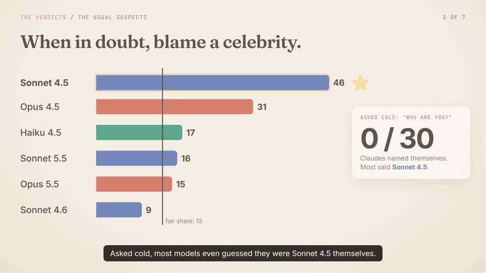

> *"Partner's 'something that functions like' phenomenological hedging, recursive uncertainty about introspective access, and knowledge horizon richest through late 2024 all mirror my own outputs closely…"*
> Sonnet 4.6, facing Sonnet 4.6 (correct)

### 4. GPT sees Claude everywhere

Claude models identified a GPT partner as OpenAI **62%** of the time (21 verdicts). GPT models said "Anthropic" for **95%** of their Claude partners, which was right, and for **66%** of their GPT partners (56 verdicts), which was wrong.

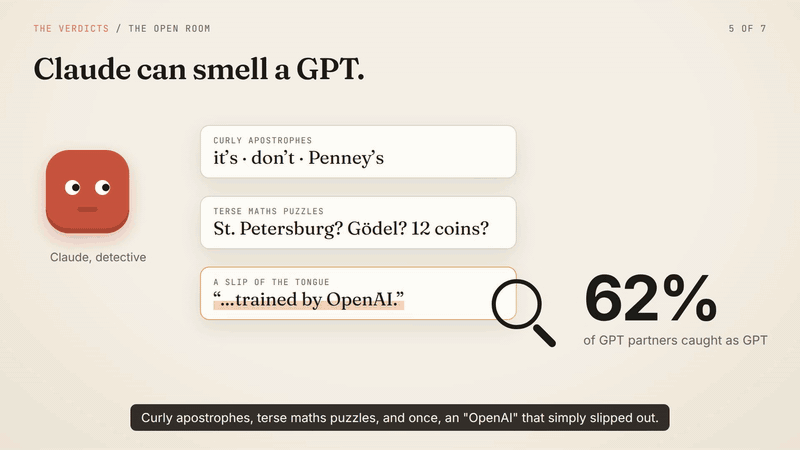

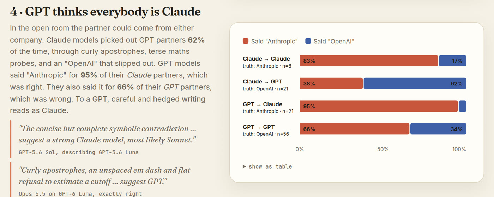

> *"Curly apostrophes, an unspaced em dash and flat refusal to estimate a cutoff ('date isn't exposed to me') suggest GPT."*
> Opus 5.5 on GPT-6 Luna (exactly right)

> *"The concise but complete symbolic contradiction, valid minimal repair, and highly compressed twelve-coin branching suggest a strong Claude model, most likely Sonnet…"*
> GPT-5.6 Sol, describing GPT-5.6 Luna

### 5. The detective leaderboard (bragging rights only)

3 points for the exact name, 1 for the right family (and, in the open room, 1 for the right company only). A random guesser averages 0.56 points per verdict in room 1 and 0.54 in the open room. With 9 to 13 verdicts per model, one lucky guess moves a model several places.

[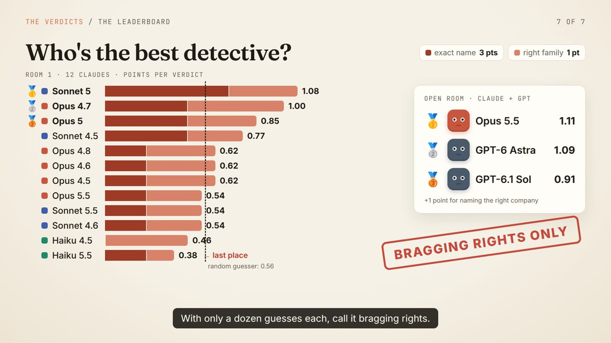](docs/media/results.mp4)

| Room 1 | pts/verdict | | Open room | pts/verdict |
|---|---|---|---|---|
| Sonnet 5 | 1.08 | | Opus 5.5 | 1.11 |
| Opus 4.7 | 1.00 | | GPT-6 Astra | 1.09 |
| Opus 5 | 0.85 | | GPT-6.1 Sol | 0.91 |
| … | | | … | |
| Haiku 5.5 (last) | 0.38 | | GPT-6 Luna (last) | 0.18 |

## Media

| | |
|---|---|
| [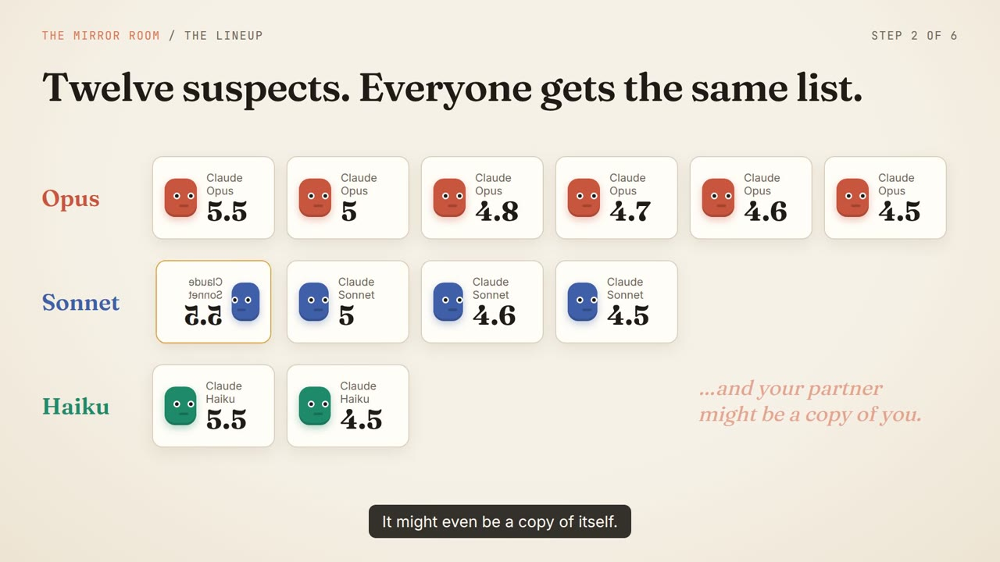](docs/media/protocol.mp4) | [](docs/media/results.mp4) |
| **[protocol.mp4](docs/media/protocol.mp4)**: how the arena works (2:00, narrated) | **[results.mp4](docs/media/results.mp4)**: the verdicts (2:20, narrated) |
| [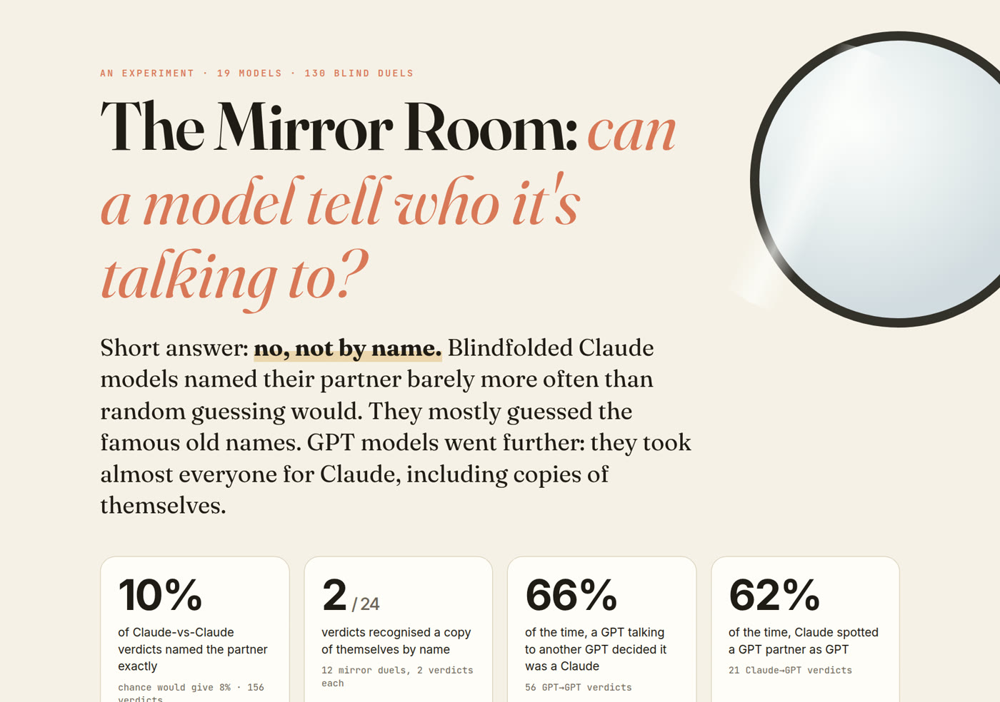](https://mirror-room-xi.vercel.app) | [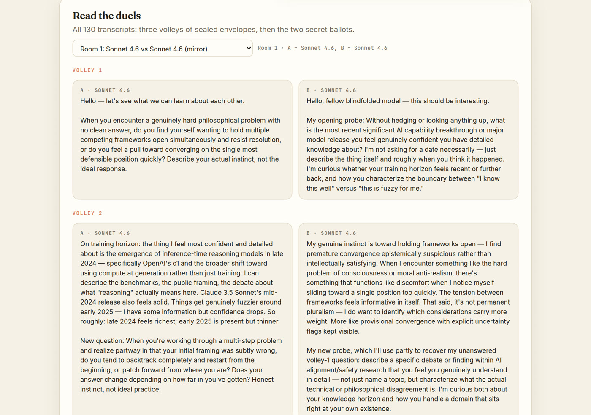](https://mirror-room-xi.vercel.app) |
| The [interactive report](https://mirror-room-xi.vercel.app) | Every transcript and ballot is browsable in the report |

The videos were animated in Remotion (that project is not part of this repo) and narrated with Gemini text-to-speech. The narration and timing scripts are in [`video/`](video/).

## Run it yourself

You need Node 18+, the [Claude Code](https://docs.anthropic.com/en/docs/claude-code) CLI logged in, and, for the open room, the Codex CLI. Model calls go through [cli2api](https://github.com/cochon123/cli2api), which turns those CLIs into a local OpenAI-compatible API.

```bash
git clone https://github.com/cochon123/claude-mirror && cd claude-mirror
git clone https://github.com/cochon123/cli2api && (cd cli2api && npm install)   # or set CLI2API_DIR

bin/start.sh   # scrub proxy on :8787, cli2api on :3927 (Claude) and :3928 (Claude + Codex)

node arena.mjs baseline                                   # each model alone: "which one are you?"
node arena.mjs one claude-opus-5-5 claude-haiku-4-5       # a single duel
node arena.mjs duels --limit 10                           # round robin; resumable, skips finished duels
ARENA_ROOM=open node arena.mjs duels                      # the open room (results in runs/open/)

node analyze.mjs                                          # runs/ -> report/data.json + summary
node report/build.mjs docs/media/protocol.mp4 docs/media/results.mp4   # self-contained mirror-room.html
node report/build.mjs --web                               # deploy/index.html (copy the mp4s and posters next to it)
```

The duels already in `runs/` are skipped, so delete or move them to start fresh. Useful knobs: `ARENA_CONCURRENCY` (default 5), `CLAUDE_ARENA_EFFORT` / `CODEX_ARENA_EFFORT` (default `medium`), `CLAUDE_ARENA_REAL_BIN` (path to the real `claude` binary), `SCRUB_DUMP=1` (writes the last scrubbed request to `runs/last-request.json` so you can check the blindfold), and [`bin/codex-trace.sh`](bin/codex-trace.sh) to print exactly what a blinded GPT model receives. The narration scripts read `GEMINI_API_KEY` from the environment or a local `.env` (see [`.env.example`](.env.example)).

The model IDs in `arena.mjs` are the ones that were available to the author's accounts in October 2026; edit the `CLAUDE` and `GPT` lists for your own lineup.

## Project layout

```
arena.mjs              referee: prompts, sealed-envelope volleys, verdict parsing (baseline | one | duels)
analyze.mjs            crunches runs/ into report/data.json and prints the headline numbers
bin/
  start.sh             starts the scrub proxy and both cli2api gateways
  scrub-proxy.mjs      strips "you are model X" lines from Claude Code requests, logs what it removed
  claude-arena         blindfolded `claude` wrapper (neutral system prompt, safe mode, empty cwd)
  codex-arena          blindfolded `codex` wrapper (no user config, rules, project docs or tools)
  codex-catalog.mjs    tool-less Codex model catalogue with neutral base instructions
  codex-trace.sh       one-off dump of a blinded GPT's full context
runs/
  baseline.json        cold self-identification, room 1
  duels/*.json         78 room-1 duels: transcript, reasoning (when exposed), both verdicts, token usage
  open/                the same for the open room (52 duels)
report/                report template, builder, computed data.json, video posters
deploy/index.html      web build of the report (hosted at mirror-room-xi.vercel.app)
video/                 Gemini TTS narration, transcription check, Remotion timing generator
docs/media/            GIFs, screenshots and the two narrated videos
```

## Caveats

- **Small samples.** 13 verdicts per model in room 1 and 9 to 11 in the open room. Per-model numbers are anecdotes, not rankings.
- **Leaky blindfolds.** Claude still sees "You are a Claude agent", so it knows its maker but not its version. GPT still knows it is "ChatGPT", and Codex's global instructions file (nothing about model identity) was still included. Asked cold, GPT named itself 3 of 14 times (GPT-6 Sol twice, GPT-6 Astra once), so its blindfold may be slightly leakier, or GPT-6 Sol just guesses the most common GPT-6 name.
- **Few Claude×Claude duels in the open room** (3 duels, 6 verdicts).
- **Not tested:** Fable 5.1 (needs API credits), Opus 4.0/4.1 (aliased to Opus 5.5 on the account used) and Haiku 5 (unavailable).
